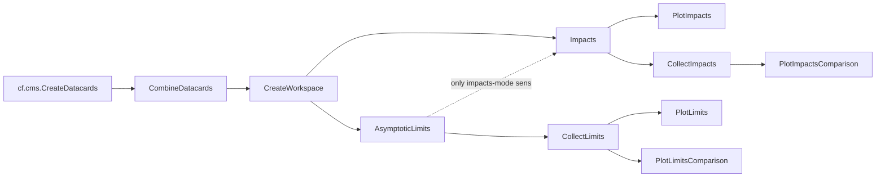

# Statistical inference with Combine

This document describes the law tasks in `mtt/tasks/inference/`, which run the CMS
[Combine](https://cms-analysis.github.io/HiggsAnalysis-CombinedLimit/) fit workflow for the Z' → tt̄ analysis:
datacards, workspaces, asymptotic limits, impacts, and the plots that aggregate them over mass points, signal
widths and inference-model variants.

- [Overview](#overview)
- [Setup and the Combine sandbox](#setup-and-the-combine-sandbox)
- [Running the tasks](#running-the-tasks)
- [Task reference](#task-reference)
- [Inference models and the mass / width grid](#inference-models-and-the-mass--width-grid)
- [Output paths](#output-paths)
- [Impacts modes](#impacts-modes)
- [Mass scans and plots](#mass-scans-and-plots)
- [Blinding](#blinding)
- [Remote jobs (HTCondor)](#remote-jobs-htcondor)
- [Developer guide](#developer-guide)
- [Troubleshooting](#troubleshooting)
- [Known limitations and ideas for the future](#known-limitations-and-ideas-for-the-future)


## Overview



| Task | What it does | Combine command |
|---|---|---|
| `CombineDatacards` | merges the per-category datacards of one inference model into one card | `combineCards.py` |
| `CreateWorkspace` | builds the RooFit workspace | `text2workspace.py` |
| `AsymptoticLimits` | expected (and optionally observed) 95% CL upper limits on the signal strength `r` | `combine -M AsymptoticLimits` |
| `Impacts` | nuisance-parameter pulls and impacts on `r` | `combineTool.py -M Impacts` |
| `PlotImpacts` | impact plot of one model | `plotImpacts.py` |
| `CollectLimits` / `CollectImpacts` | aggregate the results of many models into one csv | (python) |
| `PlotLimits`, `PlotLimitsComparison`, `PlotImpactsComparison` | plots over a scan | (python, matplotlib) |
| `...Wrapper` | run one task for several inference models | – |

Every task requires its predecessors, so running the last task of a chain is enough. The first tasks in the
chain (`CombineDatacards` to `PlotImpacts`) run **one branch per inference model** inside the Combine sandbox. The
scan tasks (`Collect*`, `Plot*Comparison`, `PlotLimits`) only read the results of those and run in the columnar
sandbox.


## Setup and the Combine sandbox

All Combine commands run in the sandbox `sandboxes/combine_cmssw.sh`: a CMSSW area containing Combine, plus a small
python venv for the python packages needed on top (`sandboxes/combine_cmssw.txt`).

| Item | Value | Where |
|---|---|---|
| Combine | `v11.0.0` (override with `CF_COMBINE_VERSION`) | `combine_cmssw.sh` |
| CMSSW / arch | `CMSSW_16_0_0`, `el9_amd64_gcc13` | `combine_cmssw.sh` |
| Install location | `$CF_COMBINE_BASE/combine_cmssw_<hash>/<version>`, `CF_COMBINE_BASE` defaults to `$CF_SOFTWARE_BASE/combine` | `setup.sh`, `_setup_combine.sh` |
| Sandbox of the Combine tasks | `bash::$MTT_BASE/sandboxes/combine_cmssw.sh` (a `..._dev.sh` variant is used if it exists) | `inference_base.py`, `law.cfg` (`combine_sandbox`) |

**First use.** The first task that needs the sandbox installs it (clone, checkout, `scram b`, venv). This takes a
while. Concurrent processes wait on a `pending_...` flag file instead of installing twice (a flag older than 30
minutes is treated as a leftover and removed).

**Updating the sandbox.** `CF_COMBINE_FLAG` in `combine_cmssw.sh` is the sandbox version. Increase it whenever the
content of the sandbox changes (e.g. a new entry in `combine_cmssw.txt`). Installed sandboxes with an older flag keep
working but print a warning. To rebuild, run any Combine task with `CF_SANDBOX_SETUP_MODE=update` (rebuild if the
flag is outdated), `reinstall` (always rebuild) or `clear` (remove only):

```shell
CF_SANDBOX_SETUP_MODE=reinstall law run mtt.CreateWorkspace --inference-model zp_m1000_w100__v2 $COMMON
```

**Configuration that must be in place** (already done for `analysis_mtt`):

- `ana.x.cmssw_sandboxes` in the analysis config lists `$MTT_BASE/sandboxes/combine_cmssw.sh`, so that remote jobs
  know about the sandbox.
- `law.cfg`: `htcondor_share_software: True`, `combine_sandbox: bash::$MTT_BASE/sandboxes/combine_cmssw.sh`, and the
  task modules under `[modules]` (`mtt.tasks.inference.{datacards,workspace,limits,impacts,collect_limits,...}`).
- `mtt/tasks/inference/__init__.py` loads `law.contrib.load("pandas")` (csv/json formatters of the scan tasks).


## Running the tasks

Throughout this document `$COMMON` stands for the arguments that select the datacard inputs:

```shell
COMMON="--version v1 --configs run3_mtt_2024_nano_v15_new --producers features --hist-producer no_trigger_weights"
```

The most important parameters, shared by all Combine tasks:

| Parameter | Default | Meaning |
|---|---|---|
| `--inference-model` | – | the model to fit, e.g. `zp_m1000_w100__v2` |
| `--workflow` | `local` | `local` or `htcondor` |
| `--asimov-data` | `True` | use an Asimov dataset (`-t -1`) instead of the data. See [Blinding](#blinding) |
| `--unblind` | `False` | required to allow fits to real data |
| `--verbosity` | `1` | passed as `-v` to Combine |
| `--print-help` | `False` | append `-h` to the Combine command to print Combine's own help |

Single model, from datacard to plot:

```shell
law run mtt.CombineDatacards --inference-model zp_m1000_w100__v2 $COMMON
law run mtt.CreateWorkspace  --inference-model zp_m1000_w100__v2 $COMMON
law run mtt.AsymptoticLimits --inference-model zp_m1000_w100__v2 --run-mode expected $COMMON
law run mtt.Impacts          --inference-model zp_m1000_w100__v2 --impacts-mode sens --workflow htcondor $COMMON
law run mtt.PlotImpacts      --inference-model zp_m1000_w100__v2 --impacts-mode sens --workflow htcondor $COMMON
```

Many models, with a wrapper (see [Wrappers](#wrappers)):

```shell
law run mtt.AsymptoticLimitsWrapper --inference-models "zp_m1000_w{10,100,300}__v2" $COMMON
```

Useful law switches:

```shell
law run <task> ... --print-output 0       # print where the output goes
law run <task> ... --remove-output 0,a,y  # remove the output of this task only (depth 0), without asking; see `law run <task> --help`
law run <task> ... --print-status 1       # show which dependencies are already done
```

`workflow_scripts/fit_workflow.sh` collects the commands of a complete fit workflow (limits, impacts, plots for several
widths). It is a working example, but the scripts in that directory are meant to be edited, not run blindly.


## Task reference

All Combine option names follow Combine's own spelling (`--rMin`, `--expectSignal`, `--cminSingleNuisFit`, ...), the
other ones are law-style (`--run-mode`, `--impacts-mode`, ...).

### CombineDatacards

Merges the datacards of all categories of the model with `combineCards.py`. The category names are taken from the
output of `cf.CreateDatacards`. Currently only models whose name contains `default` or `zp` (the ones with merged
eras) are supported.

- Output: `datacard.txt`, `combine_cards.log`
- The task fails if the merged card is empty; the stderr of `combineCards.py` is included in the error message.

### CreateWorkspace

Runs `text2workspace.py` on the merged card. No Combine option other than `--verbosity` is used.

- Output: `workspace.root`, `text2workspace.log`

### AsymptoticLimits

Runs `combine -M AsymptoticLimits` on the workspace and converts the printed limits into a csv.

| Parameter | Default | Meaning |
|---|---|---|
| `--run-mode` | `expected` | `blind`, `expected`, `observed` or `both` (`--run` of Combine) |
| `--rMin`, `--rMax` | `0.0`, `20.0` | range of the signal strength. Only encoded in the output path when not default |
| `--expectSignal` | `0.0` | inject a signal of this strength into the Asimov dataset. Only in the path when non-zero |
| `--name` | `test` | label of the Combine output (`higgsCombine.<name>...`), must not be empty |
| `--mass` | `120` | value passed as `-m`. It is **only a label** (Combine's `mH`), the signal mass comes from the inference model |
| `--saveWorkspace`, `--validateModel` | `True` | passed on to Combine |

- Output: `asymptotic_limits.root`, `asymptotic_limits.log`, `asymptotic_limits.csv`.
- The csv has the lines `limit_type,limit_value` with `expected_2.5`, `expected_16`, `expected_50`, `expected_84`,
  `expected_97.5` and, for `--run-mode both` and `observed`, `observed`.
- The task parses the Combine log. It fails if one of the five expected limits is missing, so `--run-mode observed`
  alone does not work; use `both` (and see [Blinding](#blinding)).
- Limits are on the signal strength `r`. The reference cross section of the signal is
  `cfg.x.signal_norm` (0.1 pb for every mass and width), so a limit `r` corresponds to `r × 0.1 pb`. This conversion
  is done in the plot tasks.
- Combine runs in a temporary `work/` directory next to the output (removed afterwards).

### Impacts

Runs `combineTool.py -M Impacts` in three steps, in one working directory: the initial fit (`--doInitialFit`), the fits
of all nuisance parameters (`--doFits --parallel 4`) and the json collection (`-o impacts.json`). The root files of the
individual fits are removed after the json step.

| Parameter | Default | Meaning |
|---|---|---|
| `--impacts-mode` | `bkgonly` | `bkgonly` or `sens`, see [Impacts modes](#impacts-modes) |
| `--what-to-run` | `all` | `initial_fit`, `fits`, `json` or `all`. Only the outputs of the selected steps are declared |
| `--robustFit` | `1` | `--robustFit` of Combine |
| `--cminSingleNuisFit` | `True` | `--cminSingleNuisFit` |
| `--cminFallbackAlgo` | `Minuit2,Simplex,0:0.1` | fallback minimizer, same as in the former bash workflow |
| `--rMin`, `--rMax`, `--expectSignal` | `0`, `20`, `0` | only valid in mode `sens`: they are the settings of the limits that `sens` is derived from |
| `--cleanup-root-files` | `True` | remove the intermediate root files |
| `--dry-run` | `False` | let combineTool print the commands without running them |

- Output: `initial_impacts.log`, `impacts.log`, `impacts.json`.
- The fits run as `--parallel 4` **inside one job**. For remote jobs this means one job that uses four processes,
  see [Remote jobs](#remote-jobs-htcondor).

### PlotImpacts

Runs `plotImpacts.py` on the json of `Impacts`. Takes the same `--impacts-mode`, `--rMin`, ... as `Impacts` (they select
which impacts to plot) and the layout options `--summary-plot`, `--per-page`, `--height`, `--left-margin`,
`--label-size`, `--cms-label`.

- Output: `impacts_plot.pdf`, `impacts_plot_summary.pdf` (with `--summary-plot`), `impacts_plot.log`.

### Wrappers

`CombineDatacardsWrapper`, `CreateWorkspaceWrapper`, `AsymptoticLimitsWrapper`, `ImpactsWrapper` and
`PlotImpactsWrapper` require one instance of the wrapped task per entry of `--inference-models` (comma-separated, brace
expansion is supported). All other parameters of the wrapped task are accepted by the wrapper and passed on unchanged.

```shell
law run mtt.PlotImpactsWrapper \
    --inference-models zp_m1000_w10__v2,zp_m1000_w100__v2,zp_m1000_w300__v2 \
    --impacts-mode sens --workflow htcondor --workers 3 $COMMON
```

Tasks started through a wrapper print `set_status_message not set` warnings. This is cosmetic; see
[Known limitations](#known-limitations-and-ideas-for-the-future).

### CollectLimits, CollectImpacts

Aggregate the results of all combinations of `--masses` × `--width-percentages` × `--variants`
(× `--impacts-modes`) into a csv, plus a `manifest.json` with the lists `found` and `missing`.

| Parameter | Default | Meaning |
|---|---|---|
| `--masses` | – | mass points in GeV, comma-separated |
| `--variants` | `v2` | inference-model variants, see below |
| `--width-percentages` | `10` | relative signal widths in percent of the mass |
| `--impacts-modes` (`CollectImpacts`) | `bkgonly` | which impacts modes to collect |
| `--strict` | `False` | require that every combination exists (and make the task require them) |
| `--source-csv` | – | reuse an existing aggregate instead of reading the individual results |
| `--rMin`, `--rMax`, `--expectSignal` | `0`, `20`, `0` | settings of the underlying limits (and of `sens` impacts) |

**Important:** without `--strict` these tasks do **not** run the per-mass tasks. They collect what already exists and
only log a warning for missing points. The result is written once and then counts as complete: after computing more mass
points, rerun with `--remove-output 0` (or delete the output), otherwise the old aggregate is reused.

- `limits.csv`: one row per (mass, width, variant) with the limit columns above plus `mass`, `width_pct`, `width`,
  `variant`.
- `impacts.csv`: one row per (mass, width, variant, mode, nuisance parameter) with `fit_lo/mid/hi`, `prefit_lo/mid/hi`,
  `r_down/r_nom/r_up`, `impact_r`, `param_name`, `param_type`.

### PlotLimits

Expected (and observed, if present) limits versus mass for one variant and one width: median (dashed), 68% and 95%
bands, in `σ × BR` [pb] (`r × signal_norm`), with luminosity and √s taken from the configs.

| Parameter | Default | Meaning |
|---|---|---|
| `--variant` | `v2` | variant to plot |
| `--width-percentage` | `10` | signal width in percent |
| `--include-run2` | `none` | `raw`: published Run 2 expected limit (CMS-PAS-B2G-22-006); `lumi-scaled`: the same scaled by √(138 / L<sub>Run 3</sub>) |
| `--include-theory` | `False` | draw the Run 2 (13 TeV) cross-section line of that width |

The Run 2 comparison is available for widths of 1, 10 and 30 %. The √L scaling is only valid where the analysis is
background dominated (at high mass the limit scales closer to 1/L), and the theory line is at 13 TeV while the Run 3
limits are at 13.6 TeV. Do not read a mass exclusion off its crossing with the limit. If points are missing in the
collected csv, the plot says how many.

### PlotLimitsComparison

Compares several variants at the given masses (single `--width-percentage`): ratio to a reference variant
(`--reference-variant`, default: first of `--variants`), overlay of the median limits, and, for at most five masses, a
grouped bar chart.

### PlotImpactsComparison

Compares pulls and signed impacts of the nuisance parameters in `--params` across masses and variants. One figure per
parameter and width (`--width-percentages`, comma-separated), saved as png and pdf. A parameter without any data
gets a placeholder figure that says so. `--impact-yscale symlog` helps with large impact ranges.

```shell
law run mtt.PlotImpactsComparison --masses 1200 --variants v2 --impacts-mode sens \
    --params pu,btag_light,xsec_tt --width-percentages 1,10,30 $COMMON
```


## Inference models and the mass / width grid

Models are registered in `mtt/inference/zprime.py` as `zp_m<mass>_w<width>__<variant>`, where `width` is the
**absolute** width in GeV: `(mass // 100) * width_percent`. The same formula is used by the scan tasks
(`LimitsPlottingBaseTask.model_name`), so the grid assumes masses that are multiples of 100 GeV.

Variants (the part after `__`):

| Variant | Content |
|---|---|
| `default` | first test model, kept for reference |
| `v2` | used for further studies |
| `v2__wo_qcd__dec_th` | `v2` with the processes tt, st and vv/dy/w_lnu in all regions, and decorrelated muf/mur/isr/fsr uncertainties |
| `v2_tt_only` | `v2` with only the tt process (no st and others), all regions |
| `v2_tt_st_only` | `v2` with only the tt and st processes, all regions |
| `cronly`, `stcronly`, `otherscronly` | control-region-only models (all, single-top, other backgrounds) |
| `v3` | uses differently binned fit variable to avoid empty bins |

The comments in `zprime.py` are the authoritative description of each variant.


## Output paths

Outputs live below the usual columnflow store, in the directory of the task family (`mtt.AsymptoticLimits`, ...)
and the columnflow parts (config, calibrators, selector, reducer, producers, hist producer, inference model). The
last directory is added by the Combine tasks and encodes the settings that affect the result, so runs with different
settings do not overwrite each other. Use `--print-output 0` to find a concrete path.

| Task | Last path part |
|---|---|
| `CombineDatacards` | `combined_card` |
| `CreateWorkspace` | `workspace__initial` |
| `AsymptoticLimits` | `asymptotic_limits__<run_mode>__<asimov\|data>` + `__r<rMin>_<rMax>` (if not 0–20) + `__s<expectSignal>` (if non-zero) |
| `Impacts` | `impacts__<mode>__s<s>_r<rMin>_<rMax>` + `__data` (if not Asimov) |
| `PlotImpacts` | `impacts_plot__<mode>__s<s>_r<rMin>_<rMax>` + `__data` |
| `CollectLimits` | `<masses>__w<widths>__<variants>` + range tag |
| `CollectImpacts` | `<masses>__w<widths>__<variants>__<modes>` + range tag |
| plots | scan id (+ `__w<width>`, variants, `impact_yscale` if not linear, range tag) |

`<masses>` is `m<min>-<max>_n<count>_<hash of the mass list>`, so different mass lists never share a folder.

In `Impacts` the settings in the name are the ones the fits actually use: fixed values for `bkgonly`
(`s0.0_r-10.0_10.0`), the ones passed to the underlying limits for `sens`. Anything that is not encoded in the path
(for example the factors that turn the limit into the `sens` range) requires `--remove-output` after a change.

## Impacts modes

An impact is the shift of the fitted signal strength `r` when a nuisance parameter is moved by ±1σ. It is evaluated on
an Asimov dataset with signal strength `expectSignal`, so the injected `r` matters.

| `--impacts-mode` | Injected `r`, fit range | Use |
|---|---|---|
| `bkgonly` | `r = 0`, range −10 … 10 (as in the former bash workflow) | which nuisances limit the sensitivity with no signal. Nuisances that only act on the signal (signal cross section, signal PDF/scale, signal shape) have no impact here, since there is no signal to scale |
| `sens` | `r = expected_50` (median expected limit), `r_max = 4 × expected_97.5`, `r_min = −0.3 × r_max`, all from the `AsymptoticLimits` the task requires | impacts at a signal that is just about excluded. Signal-only nuisances now matter, with an impact proportional to the injected `r` |

Points to keep in mind:

- In `sens` mode, `--rMin`, `--rMax` and `--expectSignal` are the settings of the limits the impacts are derived from (so
  they are part of the path); the fit settings are computed from the limit result. In `bkgonly` they must stay at their
  defaults, otherwise the task raises a `ValueError`.
- Impacts are in units of `r`. Since `r = 1` corresponds to 0.1 pb for every mass and width, and the limits change by
  orders of magnitude over the mass range, impacts in `sens` mode are not directly comparable between mass points in
  absolute terms. For signal-only nuisances, divide by the injected `r` to get the fractional effect on the signal yield.
- The injected `r` is not a prediction. It is the median expected limit, not a theory cross section.
- New fixed modes are added in `FIXED_FIT_SETTINGS` in `impacts.py` (`(expectSignal, rMin, rMax)`).


## Mass scans and plots

A typical scan over mass points and widths:

```shell
# 1. limits for all points of the 10% width, as an HTCondor workflow
#    (the model names contain the absolute width, so build the list in a loop)
models=""
for mass in 1000 2000 3000; do
    models+="zp_m${mass}_w$(( mass / 100 * 10 ))__v2,"
done
law run mtt.AsymptoticLimitsWrapper --inference-models "${models%,}" --workflow htcondor $COMMON

# 2. aggregate (does not run step 1, see CollectLimits above)
law run mtt.CollectLimits --masses 1000,2000,3000 --variants v2 --width-percentages 10 $COMMON

# 3. plot
law run mtt.PlotLimits --masses 1000,2000,3000 --variant v2 --width-percentage 10 --include-run2 lumi-scaled $COMMON
```

`workflow_scripts/fit_workflow.sh` does the same for several widths and also runs the impacts.


## Blinding

All default settings use Asimov data, so results do not depend on the data. To protect this, `CombineBaseTask` raises an error when a task would use real data, that is when `--asimov-data False`
or `--run-mode observed|both` is requested, unless `--unblind` is passed too.

With `--asimov-data True`, `--run-mode expected` and `--run-mode blind` give the same kind of result (expected limits for
the pre-fit background-only Asimov dataset). Only run an unblinded task after the unblinding procedure of the analysis
has been followed. `PlotImpacts` on data would show the fitted `r`; check `plotImpacts.py -h` for `--blind`.


## Remote jobs (HTCondor)

`--workflow htcondor` submits one job per branch (one inference model per task, so one job). The job runs in the same
Combine sandbox. There is no per-job installation:

- With `htcondor_share_software: True` (set in `law.cfg`), the job uses the installation next to the shared
  columnflow venvs: `$(dirname $CF_VENV_BASE)/combine`. **Run any Combine task locally once before submitting jobs**, so
  that the sandbox exists there.
- If the job finds neither the shared installation nor a bundle, it stops with **exit code 22** and the message
  "combine sandbox ... not found in job configuration".
- `Impacts` runs its fits with `--parallel 4` inside the job, but a job requests one CPU by default. Set the
  requested CPUs of the job (`--htcondor-cpus`) when running impacts on the batch system.

`Collect*` tasks are local only (`workflow = "local"`).


## Developer guide

### File map

| File | Content |
|---|---|
| `inference_base.py` | `InferenceBaseTask`: columnflow requirements, sandbox, `run_command`, branch map |
| `combine_base.py` | `CombineBaseTask`: `--asimov-data`, `--unblind`, the option guard and the blinding guard |
| `mixins.py` | Combine option groups (`Common*OptionsMixin`, `AsymptoticLimitsMixin`, ...) mirroring `combine -h` |
| `datacards.py`, `workspace.py`, `limits.py`, `impacts.py` | the Combine tasks |
| `collect_limits.py`, `collect_impacts.py` | aggregation, plus `LimitsPlottingBaseTask` shared by all scan tasks |
| `plot_limits.py`, `compare_impacts.py` | scan plots |
| `wrappers.py` | `inference_models_wrapper` factory |
| `sandboxes/combine_cmssw.sh`, `_setup_combine.sh`, `combine_cmssw.txt` | the sandbox |

### Conventions

- **Outputs:** use `self.target(...)` and extend `store_parts()` with `parts.insert_after(anchor, name, value)`, where
  `name`/`value` encode every setting that changes the result. If the anchor key does not exist, the part is appended
  at the end.
- **Running commands:** build the command as a string in a `build_command(s)` method (testable without Combine), run it
  with `self.run_command(cmd, echo=True, cwd=workdir)`. On a non-zero exit code it raises an exception with the last 30
  lines of the output. Write the log with `self.output()[...].dump(outp, formatter="text")`.
- **Decorators:** `run()` is decorated with `@law.decorator.log` and `@law.decorator.safe_output`, the latter removes
  partial outputs when the task fails.
- **Working directories:** commands that write files (`higgsCombine*.root`, ...) run in a `work/` directory next to the
  output and are cleaned up afterwards, never in the current directory.

### The option guard (`implemented_options`)

The mixins expose many Combine options as parameters. To make sure no option is silently ignored, every Combine task
declares the options it translates into the command in the class attribute `implemented_options`. In `__init__`,
`CombineBaseTask.check_unimplemented_options` raises a `NotImplementedError` if a parameter from one of the mixins
(`COMBINE_OPTION_MIXINS`) has a non-default value and is not in that set.

To implement a new option, say `--rRelAcc` for `AsymptoticLimits`:

1. add `command_to_run += f" --rRelAcc {self.rRelAcc}"` to `build_command` (only when it differs from the default, if
   that keeps old commands unchanged),
2. add `"rRelAcc"` to `AsymptoticLimits.implemented_options`,
3. if it changes the result, put it into the output path in `asymptotic_limits_name()`,
4. if the option is relevant for tasks that require the limits (e.g. `Impacts` in `sens` mode), check how it is
   forwarded in `Impacts.requires`.

### Adding a new Combine method

For example `FitDiagnostics`:

1. create the task class deriving from `CombineBaseTask` plus the mixins matching the method's options, set
   `implemented_options`,
2. implement `requires()` (typically the workspace), `store_parts()`, `output()`, `build_command()` and `run()`, following
   `limits.py`,
3. add the module to `[modules]` in `law.cfg` and run `law index`,
4. add a wrapper in `wrappers.py` if useful, and an entry to this document.

### Code quality

`flake8` with the repo's `.flake8` (120 characters, double quotes) must pass. The pure helpers (`get_fit_settings`,
`read_expected_limits`, `build_command(s)`, `build_combine_cards_cmd`, the limit-log parser) need no Combine and are
good candidates for unit tests.


## Troubleshooting

| Symptom | Cause / fix |
|---|---|
| `NotImplementedError: ... does not implement the combine option(s) ...` | the option is exposed but not translated into the command, see the option guard above |
| `ValueError: rMin, rMax and expectSignal only apply in impacts_mode 'sens'` | those options were set together with `--impacts-mode bkgonly` |
| `ValueError: ... would use real data ...; pass --unblind` | `--asimov-data False` or `--run-mode observed/both`, see [Blinding](#blinding) |
| Remote job fails with exit code 22 | the Combine sandbox does not exist in the shared software area yet. Run a Combine task locally first |
| `command failed with exit code N: ...` | the exception contains the last 30 lines of Combine's output. The complete output is in the task's `.log` file next to the outputs, or rerun with the command printed (`echo=True`) |
| `limits log is missing expected_... in <file>` | Combine did not print all five expected limits. Look at the log; typically a failed fit or a wrong `--run-mode` |
| `combineCards.py created an empty datacard` | the stderr of `combineCards.py` is part of the message, usually a missing or broken per-category card |
| `name must not be empty` | `--name ""` for `AsymptoticLimits` (Combine would use `Test` and the output could not be found) |
| plots do not appear / are missing points | `Collect*` reuses an old aggregate, or points were missing when it was created. Rerun with `--remove-output 0`, and use `--strict` if all points must exist |
| old plots remain after a change of the path scheme | `--remove-output` only removes the folder of the current path. Delete the old folders by hand |
| `set_status_message not set` warnings with wrappers | cosmetic, see below |
| `Impacts` is slow on the batch system | the fits run with `--parallel 4` in one job on one CPU, request more CPUs |


## Known limitations and ideas for the future

Known limitations:

- **Wrapper warnings.** Tasks started through a wrapper log `set_status_message not set`, and
  `InferenceBaseTask.scheduler_messages = None` works around a crash in the HTCondor poll loop. The suspected cause is
  law's instance cache being bypassed by an unhashable list parameter, leading to duplicate task instances. The jobs
  and outputs are not affected.
- `Collect*` aggregates are not invalidated when single mass points change, and missing points are only reported via a
  warning (and in `PlotLimits`, on the plot).
- `--mass` is only a label (default 120). It does not follow the signal mass.
- The Run 2 limit csvs are read from a fixed path (`PATH_TO_RUN2_LIMITS` in `plot_limits.py`).
- Default `--variants` of `PlotLimitsComparison` is `default,v2`.
- `--run-mode observed` alone cannot succeed (the log parser requires the expected limits).
- Only merged datacards are supported at the moment. The per-era combinations of the former bash workflow (24, 25, 2425) would need
  separate inference models.

Ideas for further iterations:

- Further Combine methods as tasks: `FitDiagnostics` (post-fit shapes, pulls), goodness of fit (saturated),
  `ValidateDatacards.py`, `checkNuisances`, signal-injection and bias tests, significance after unblinding, a limit
  breakdown by systematic group (frozen groups versus stat-only).
- Cross-check the asymptotic limits with `HybridNew` at a few points, in particular at high mass, for wide signals and
  in bins with very few background events.
- A physically motivated impacts mode (injected signal at the theory cross section) once 13.6 TeV cross sections are
  available for the whole grid; 13.6 TeV theory lines for `PlotLimits`.
- Check the impacts json for failed or NaN fits instead of trusting combineTool, and consider
  `--cminDefaultMinimizerStrategy 0` for speed.
- Write the Combine version and the exact commands into a manifest next to each output.
- Keep the signal normalisation in one place: `PlotLimits` takes `signal_norm` from the first config and assumes it is
  the same for all configs. This should always be the case.
